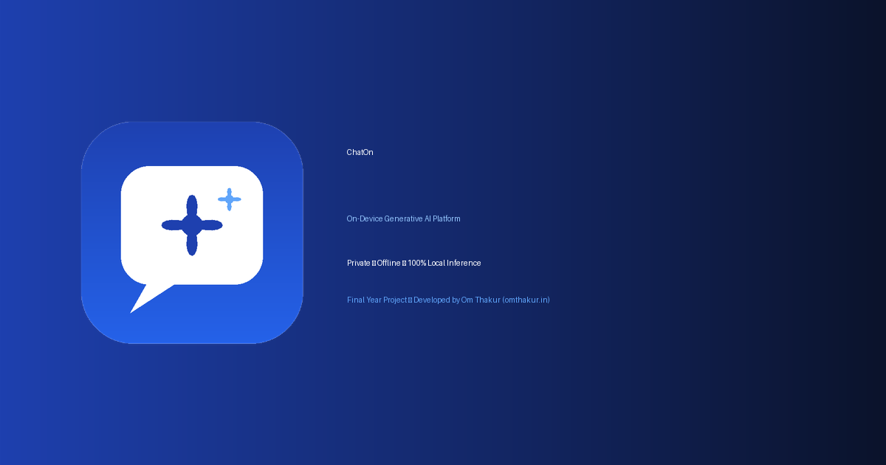
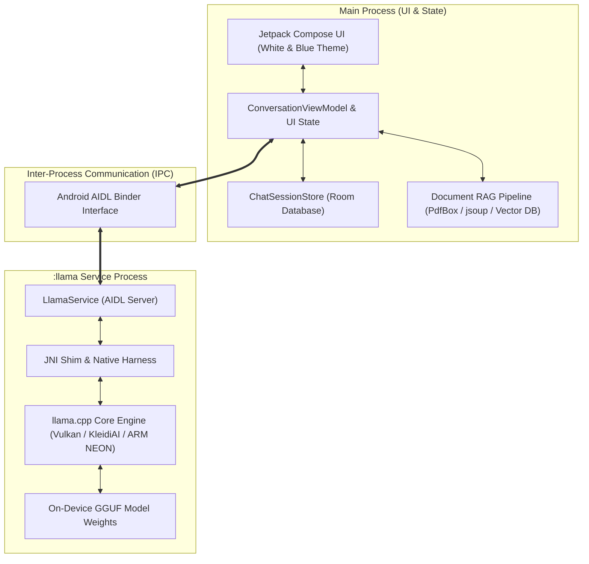

# ChatOn App — On-Device Generative AI Platform

<p align="center">
  <b>A Privacy-Preserving, Offline Large Language Model Mobile Platform for Android</b><br>
  <i>Developed by <b>Om Thakur</b> • <a href="https://omthakur.in">omthakur.in</a></i>
</p>

<p align="center">
  <br><br>
  
</p>

---

## 📌 Project Overview

**ChatOn App** is an engineering capstone project designed and developed by **Om Thakur**. It is a fully offline, privacy-first Android application capable of running state-of-the-art quantized Large Language Models (LLMs) directly on consumer mobile hardware without relying on cloud APIs, centralized servers, or remote computation.

Powered by a native C++ inference engine (`llama.cpp`) combined with a modern **White & Blue** Jetpack Compose user interface, **ChatOn** delivers desktop-grade generative AI capabilities directly to smartphones and tablets.

---

## ✨ Key Features & Architectural Innovations

### 1. 100% On-Device Inference (Zero Data Egress)
- Executes open-weight models in **GGUF** format entirely within the device's CPU, GPU (via Vulkan compute shaders), and NPU/NEON vector instructions.
- Conversations, documents, images, and system prompts never leave the device.

### 2. Modern White & Blue UI Design System
- **Crisp Aesthetic:** Built with a custom White & Blue palette (Deep Royal Blue `#1E40AF`, Electric Azure `#2563EB`, Ice-Blue `#F0F7FF`, Pure White `#FFFFFF`).
- **Fluid Spring Animations:** Integrated Compose motion physics for chat bubble entry, smooth accordion expansion for reasoning/thinking steps, and interactive micro-interactions on buttons.
- **Animated Wave Thinking Indicator:** Real-time multi-dot pulsating wave reflecting token generation cycles.
- **Morphing Action Capsule:** Floating input bar featuring an animated circular action button that smoothly transitions between idle, send, and stop states.

### 3. On-Device Retrieval-Augmented Generation (RAG)
- Users can attach PDF, Word (.docx), EPUB, HTML, or Markdown documents directly to any conversation.
- Semantic chunking and vector embeddings are generated on-device using quantized embedding models, enabling intelligent document Q&A without cloud dependencies.

### 4. Multimodal Vision Support
- Chat with images and photos from camera or gallery using vision-capable architectures (such as Gemma, Qwen 3.5 VL, and Ministral).

### 5. Deep Thinking & Reasoning Support
- Fully displays internal chain-of-thought tokens from reasoning models (like DeepSeek R1 Distill) inside a collapsible, timed reasoning capsule.

### 6. Process-Isolated Execution Architecture
- The native inference engine runs in a dedicated `:llama` background process communicating with the UI via Android Interface Definition Language (AIDL).
- If a heavy model triggers an Out-Of-Memory (OOM) or native crash, the main UI process remains unaffected and gracefully reloads the session.

---

## 🏗️ System Architecture



---

## 📊 Supported Model Families

| Model Family | Quantization Format | Architecture / Provider |
| :--- | :--- | :--- |
| **DeepSeek R1 Distill** | Q4_K_M GGUF | DeepSeek / Reasoning |
| **Qwen 3.5 & 3** | Q4_K_M / Q3_K_M | Alibaba / Vision + Text |
| **Gemma 4 & 3** | Q4_K_M | Google DeepMind |
| **Llama 3.2 & 3.1** | Q4_K_M | Meta AI |
| **Phi-4 Mini** | Q4_K_M | Microsoft Research |
| **Custom GGUF Models** | User Selected | Local Storage Import |

---

## 🛠️ Build & Installation Guide

### Prerequisites
- **Android Studio:** Ladybug (2024.3.1+) or newer
- **Android SDK:** Platform 35 / 36
- **Android NDK:** Version `27.2.12479018`
- **CMake:** `3.31.6`
- **Minimum OS:** Android 8.0 (API Level 26) or higher

### Steps to Build
1. Clone the repository:
   ```bash
   git clone https://github.com/MonsterFlick/ChatOn.git
   ```
2. Open the project in Android Studio by selecting the `android/` directory (`ChatOn/android`).
3. Connect an Android device with USB Debugging enabled (or launch an x86_64 emulator).
4. Run:
   ```bash
   ./gradlew assembleDebug
   ```
   Or click **Run 'app'** in Android Studio.

---

## 👨‍💻 Developer & Project Credits

- **Project Developer:** Om Thakur
- **Portfolio & Inquiries:** [omthakur.in](https://omthakur.in)
- **Contact Email:** [omthakur2366@gmail.com](mailto:omthakur2366@gmail.com)
- **Academic Context:** Final Year Engineering Project

---

## 📄 License
This project is open-source under the MIT License.
